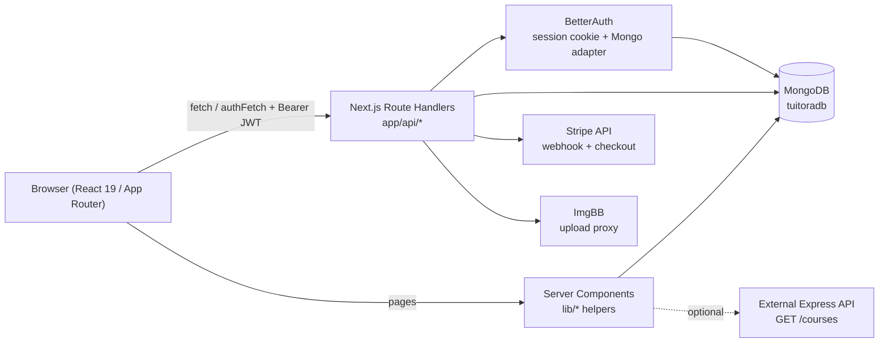

<div align="center">

# MentorLagbe — Tuition & Mentorship Marketplace

**Repo:** `tuitora-frontend` · A full-stack Next.js app where students find tutors, tutors post tuition listings, and admins moderate the platform.


**Live structure:** Next.js App Router pages + built-in Route Handlers (no separate backend required) · [MongoDB `tuitoradb`](#architecture)

</div>

> **বাংলায় সংক্ষেপ:** এটি একটি অনলাইন টিউশন মার্কেটপ্ল্যাস — শিক্ষার্থীরা টিউশন খুঁজে আবেদন করে, টিউটররা টিউশন পোস্ট করে, এবং অ্যাডমিন সমস্ত কিছু অনুমোদন ও ব্যবস্থাপনা করে। লগইন/সাইনআপ (BetterAuth + Google), JWT, স্ট্রাইপ পেমেন্ট দিয়ে PRO প্ল্যান, রিভিউ, ফেভারিট, ফিল্টার-সহ ব্রাউজিং — সবই এই Next.js অ্যাপের ভেতরেই আছে।

---

## Table of Contents

- [What this project does](#what-this-project-does)
- [Features](#features)
- [Tech stack](#tech-stack)
- [Quick start](#quick-start)
- [Environment variables](#environment-variables)
- [Available scripts](#available-scripts)
- [Project structure](#project-structure)
- [Architecture](#architecture)
- [Pages & routes](#pages--routes)
- [API reference](#api-reference)
- [Roles & permissions](#roles--permissions)
- [Plans & limits](#plans--limits)
- [Authentication flow](#authentication-flow)
- [Payment (PRO upgrade) flow](#payment-pro-upgrade-flow)
- [Seed data](#seed-data)
- [Troubleshooting](#troubleshooting)
- [Contributing](#contributing)
- [License](#license)

---

## What this project does

MentorLagbe is a **tuition/mentorship marketplace** with three kinds of users:

- **Students** browse approved tuitions, filter/search them, save favorites, apply for a specific time slot, track applications, and review a tutor after being accepted.
- **Tutors** (also called *teachers* in older route aliases) post tuition listings with time slots, manage their listings, and accept or reject student applicants.
- **Admins** moderate tuition approvals, manage users and roles, and view platform stats and the payment ledger.

The entire backend lives inside this repository as **Next.js Route Handlers** under `app/api/`, talking to **MongoDB**. Authentication is handled by **BetterAuth** (email/password + Google OAuth) with a custom **JWT bridge** for client-side API calls. Payments are handled by **Stripe** (one-time payment → PRO plan).

## Features

| Area | What's included |
|---|---|
| 🔐 Auth | Email/password + Google sign-in, email verification flows, HTTP-only cookies, safe post-login redirects (`callbackURL`) |
| 👥 Roles | Student / Tutor / Admin with server-side enforcement on every privileged route |
| 📚 Tuitions | Create, edit, browse, search, filter (subject, class, mode, location, fee, days), sort, paginate, shareable URLs |
| 📅 Slots & bookings | 7 fixed daily slots; one active application per student per tuition; accept/reject/cancel frees the slot |
| ⭐ Reviews | One review per tutor, only after the tutor accepted the student |
| 🔖 Favorites | Saved tuitions mirrored to MongoDB + `localStorage` |
| 💳 Payments | Stripe Checkout Session + embedded Payment Element, signed webhook, idempotent PRO activation |
| 🛡️ Plan limits | Free tutor: 2 posts · Free student: 5 applications (enforced server-side) |
| 🎨 UX | Dark/light theme (press **`d`** to toggle), `sonner` toasts, responsive role-based dashboards, loading/error/404 boundaries |
| 📊 Admin | Overview stats, user/role management, tuition approval queue, payment transactions |
| 🌱 Demo data | Idempotent seed script with tutors, students, 12 tuitions, bookings, and reviews |

## Tech stack

| Layer | Technology |
|---|---|
| Framework | Next.js 16 (App Router), React 19, TypeScript (strict) |
| Styling | Tailwind CSS v4, shadcn/ui (`base-lyra`, zinc), `@base-ui/react`, `class-variance-authority`, `tw-animate-css` |
| Database | MongoDB via official `mongodb` driver (DB: `tuitoradb`) |
| Auth | BetterAuth + `@better-auth/mongo-adapter`, custom HS256 JWT (`lib/jwt.ts`) |
| Payments | `stripe` (server) + `@stripe/stripe-js` (client) |
| Images | ImgBB upload proxy (`app/api/upload/route.ts`) |
| Icons / feedback / themes | `lucide-react`, `react-icons`, `sonner`, `next-themes` |
| Tooling | ESLint 9 (Next flat config), Prettier 3 (Tailwind plugin), `tsc --noEmit` |

## Quick start

### Prerequisites

- **Node.js** 20.9+ (Next.js 16 requirement) and npm
- A **MongoDB** connection string (local or Atlas)
- Optional: Stripe, Google OAuth, and ImgBB credentials for those features

### 1. Install & run

```bash
git clone https://github.com/engr-billalhossain/tuitora-client.git
cd tuitora-frontend
npm install
cp .env.example .env   # if provided; otherwise create .env using the table below
npm run dev            # http://localhost:3000
```

> There is currently no committed `.env.example` — copy the template from [Environment variables](#environment-variables) into a new `.env` file.

### 2. Verify the setup

```bash
npm run typecheck   # TypeScript
npm run lint        # ESLint
npm run build       # production build
```

### 3. First login

Sign up at `/sign-up` as a **student** or **tutor** (admin cannot be self-assigned). To create an admin, change a user's role from `/dashboard/admin/users`, or update the `role` field of a user document in MongoDB.

## Environment variables

All secrets stay on the server except the explicitly public keys. `.env*` is git-ignored — **never commit real credentials**.

| Variable | Required | Used for |
|---|---|---|
| `MONGODB_URI` | ✅ | MongoDB connection (database `tuitoradb`) |
| `BETTER_AUTH_SECRET` | ✅ | BetterAuth signing secret; fallback for JWT signing |
| `BETTER_AUTH_URL` | ✅ | BetterAuth base URL (e.g. `http://localhost:3000`) |
| `GOOGLE_CLIENT_ID` | Google login | OAuth client ID |
| `GOOGLE_CLIENT_SECRET` | Google login | OAuth client secret |
| `BASE_URL` | Recommended | Server-side absolute URL |
| `NEXT_PUBLIC_BASE_URL` | Recommended | Client-visible base URL and browse fallback |
| `IMAGEBB_API_KEY` | Image upload | Server-side ImgBB API key |
| `STRIPE_SECRET_KEY` | Payments | Stripe server SDK |
| `NEXT_PUBLIC_STRIPE_PUBLISHABLE_KEY` | Payments | Stripe.js publishable key |
| `STRIPE_WEBHOOK_SECRET` | Payments | Verifies Stripe webhook signatures |
| `BACKEND_API_URL` | Optional | External Express API base for browsing; falls back to `NEXT_PUBLIC_BASE_URL`, then direct MongoDB |
| `JWT_SECRET` | Optional | JWT signing; falls back to `BETTER_AUTH_SECRET` |

Template:

```env
MONGODB_URI="mongodb+srv://<user>:<password>@<cluster>/"
BETTER_AUTH_SECRET="a-long-random-string"
BETTER_AUTH_URL="http://localhost:3000"
BASE_URL="http://localhost:3000"
NEXT_PUBLIC_BASE_URL="http://localhost:3000"

GOOGLE_CLIENT_ID=""
GOOGLE_CLIENT_SECRET=""
IMAGEBB_API_KEY=""

NEXT_PUBLIC_STRIPE_PUBLISHABLE_KEY=""
STRIPE_SECRET_KEY=""
STRIPE_WEBHOOK_SECRET=""

# optional
# BACKEND_API_URL=""
# JWT_SECRET=""
```

Stripe webhook (local dev): forward events to `/api/stripe/webhook` with `stripe listen --forward-to localhost:3000/api/stripe/webhook` and put the printed `whsec_...` value in `STRIPE_WEBHOOK_SECRET`.

## Available scripts

| Command | Description |
|---|---|
| `npm run dev` | Start the dev server |
| `npm run build` | Production build |
| `npm run start` | Serve the production build |
| `npm run lint` | Run ESLint |
| `npm run typecheck` | Run `tsc --noEmit` |
| `npm run format` | Format `**/*.{ts,tsx}` with Prettier |
| `npm run seed` | Seed demo data into MongoDB (see [Seed data](#seed-data)) |

## Project structure

```
tuitora-frontend/
├── app/
│   ├── (auth)/                 # /sign-in, /sign-up (route group)
│   ├── api/                    # Backend Route Handlers
│   │   ├── auth/[...all]/      # BetterAuth catch-all
│   │   ├── auth/token/         # JWT issuer
│   │   ├── admin/              # overview, users, payments
│   │   ├── stripe/             # checkout-session, payment-intent, verify, webhook
│   │   ├── tuitions/           # list/create, [id], mine/[id]
│   │   ├── bookings/ favorites/ reviews/ profile/ upload/
│   │   └── checkout_sessions/  # legacy checkout redirect
│   ├── dashboard/              # role-guarded dashboards (admin / tutor / student)
│   ├── tuitions/               # /tuitions and /tuitions/[id]
│   ├── checkout/, payment/     # checkout + success/cancel pages
│   ├── about/ contact/ help/ how-it-works/ pricing/ privacy/ terms/
│   ├── layout.tsx globals.css  # root layout, theme, fonts, toaster
│   └── loading.tsx error.tsx global-error.tsx not-found.tsx
├── components/
│   ├── ui/                     # shadcn/ui primitives
│   ├── home/                   # landing sections
│   ├── tuitions/               # browser, cards, booking & review controls
│   ├── dashboard/              # shared dashboard sidebar/stats
│   ├── Navbar.tsx Footre.tsx   # global chrome (filename "Footre" is intentional)
│   └── theme-provider.tsx user-menu.tsx
├── lib/
│   ├── auth.ts auth-client.ts auth-token.ts jwt.ts   # auth + JWT bridge
│   ├── mongodb.ts tuitionDb.ts                       # DB connections
│   ├── stripe.ts payments.ts                        # Stripe helpers
│   ├── plans.ts plan-limits.ts                       # pricing + free limits
│   ├── browse.ts browseFilters.ts browseIcons.ts     # search/filter/sort
│   ├── tuitions.ts reviews.ts slots.ts               # domain helpers
│   ├── actions/                                      # server actions
│   └── utils.ts validation.ts pro.ts
├── hooks/                      # currently empty (only .gitkeep)
├── scripts/                    # seed.mjs + seed-data.json
├── public/                     # avater.png, admin.png, bannerr.png (names intentional)
├── components.json             # shadcn config
└── ...                         # tsconfig, eslint, prettier, postcss, next config
```

> Some filenames contain typos that are **part of the import paths** (`Footre.tsx`, `avater.png`, `bannerr.png`) — don't "fix" them without updating imports. `lib/stripe.ts` is the Stripe helper (there is no `stripes.ts`).

## Architecture



**MongoDB collections:** `user`, `courses` (tuitions), `bookings`, `reviews`, `favorites`, `payments`, plus BetterAuth's own collections (`session`, `account`, `verification`).

**Tuition approval state:** `pending → approved | rejected` (older code also uses `declined`). Only approved, active tuitions are visible to students.

## Pages & routes

| Route | Access | Purpose |
|---|---|---|
| `/` | Public | Landing page (banner, featured tuitions, subjects, top tutors/reviews, pricing) |
| `/tuitions`, `/tuitions/[id]` | Public | Browse with filters; tuition details + apply/review |
| `/sign-in`, `/sign-up` | Guest | BetterAuth auth pages |
| `/pricing`, `/checkout`, `/payment/success`, `/payment/cancel` | Public/User | PRO upgrade flow |
| `/about`, `/contact`, `/help`, `/how-it-works`, `/privacy`, `/terms` | Public | Static informational pages |
| `/profile` | User | Public profile view |
| `/dashboard` | Auth | Redirects to the role-specific dashboard |
| `/dashboard/admin/*` | Admin | Overview, users, tuitions, payments, transactions |
| `/dashboard/tutor/*` | Tutor | Dashboard, post-tuition, my-tuitions, applicants |
| `/dashboard/student/*` | Student | Dashboard, saved, my-applications, applications |
| `/dashboard/teacher/*` | Tutor (legacy alias) | Mirror of the tutor pages |
| `/dashboard/profile` | Auth | Edit own profile |

The `app/dashboard/layout.tsx` shell redirects unauthenticated visitors to `/sign-in` and users visiting the wrong role segment away from it.

## API reference

All endpoints are relative to `/api`. Role checks are enforced server-side via the BetterAuth session; privileged calls may also send `Authorization: Bearer <jwt>` from `authFetch`.

| Endpoint | Methods | Access | Description |
|---|---|---|---|
| `auth/[...all]` | GET, POST | Public | BetterAuth handler (sign-in, sign-up, OAuth, session, sign-out) |
| `auth/token` | GET | Auth | Issue a 1-hour JWT from the current session |
| `tuitions` | GET, POST | Public / Tutor | Browse approved tuitions; tutor creates a post (free-plan limit) |
| `tuitions/[id]` | PATCH | Admin | Approve/decline/edit a tuition |
| `tuitions/mine/[id]` | PATCH | Tutor | Edit own tuition (cannot change approval status) |
| `bookings` | GET, POST, PATCH, DELETE | Student / Tutor | List, apply, accept/reject, cancel applications |
| `favorites` | GET, POST, DELETE | Student | Saved tuitions |
| `reviews` | GET, POST | Student | Reviews (accepted booking required, one per tutor) |
| `profile` | GET, PATCH | Auth | Sanitized self-profile (role/plan fields cannot be written) |
| `upload` | POST | Auth | Image upload proxy to ImgBB |
| `stripe/payment-intent` | POST | Auth | Create PaymentIntent using the server-side price |
| `stripe/checkout-session` | POST | Auth | Create a hosted Stripe Checkout Session |
| `stripe/verify` | POST | Auth | Fallback verification of a paid session/intent → grants PRO |
| `stripe/webhook` | POST | Stripe | Signed webhook → grants PRO and records the payment |
| `checkout_sessions` | POST | Auth | Legacy redirect to `/checkout?plan=...` |
| `admin/overview` | GET | Admin | Stats, approval queue, activity |
| `admin/users` | GET, PATCH | Admin | User list and role changes |
| `admin/payments` | GET | Admin | Payment ledger |

Optional external backend contract: `GET {BACKEND_API_URL}/courses` → `{ tuitions, pagination, facets }`; if unavailable, `lib/browse.ts` queries MongoDB directly.

## Roles & permissions

| Action | Student | Tutor | Admin |
|---|:---:|:---:|:---:|
| Browse tuitions / save favorites | ✅ | ✅ | ✅ |
| Apply for a slot / review a tutor | ✅ | — | — |
| Post & edit own tuitions | — | ✅ | — |
| Accept/reject applicants | — | ✅ | — |
| Approve/decline tuitions, change roles, view payments | — | — | ✅ |

Role sanitization lives in `lib/auth.ts`: `tutor`/`teacher` normalize to `tutor`; anything else becomes `student`. **Admin is never self-assignable** — it can only be granted through `/api/admin/users` or directly in the database.

## Plans & limits

| Plan | Tutor | Student | How to upgrade |
|---|---|---|---|
| Free | 2 tuition posts | 5 applications | Default |
| Pro Tutor | Unlimited posts | — | One-time **$15.00** (`1500` cents) |
| Pro Student | — | Unlimited applications | One-time **$10.00** (`1000` cents) |

Prices and the `tuitora_pro_upgrade` purpose marker live in `lib/plans.ts`; limits are in `lib/plan-limits.ts`. Amounts are always derived server-side — the browser never sends a price.

## Authentication flow

1. User signs in/up with BetterAuth → HTTP-only session cookie.
2. `GET /api/auth/token` exchanges the session for a short-lived (1 hour) HS256 JWT signed with `JWT_SECRET` (fallback `BETTER_AUTH_SECRET`).
3. `lib/auth-token.ts` caches the token in memory + `sessionStorage` (keys `mentorlagbe:session-token*`) and `authFetch` attaches `Authorization: Bearer <token>`.
4. Server route handlers primarily re-validate the BetterAuth session cookie and check the role; plan/role/pro fields are server-owned and cannot be written by the client.

## Payment (PRO upgrade) flow

1. User chooses a plan on `/pricing` → `/checkout`.
2. Client requests `/api/stripe/payment-intent` or `/api/stripe/checkout-session`; server reads the amount from `lib/plans.ts`.
3. Stripe processes the one-time payment.
4. `/api/stripe/webhook` verifies the signature with `STRIPE_WEBHOOK_SECRET`, checks the purpose marker and exact price, then **idempotently** sets the user's `plan` to `pro` and records a `payments` document.
5. `/api/stripe/verify` exists as a fallback for clients that need immediate confirmation.
6. Success/cancel land on `/payment/success` and `/payment/cancel`.

When configuring Stripe, use **USD** and ensure the price matches the constants above, otherwise verification will reject the upgrade.

## Seed data

`npm run seed` loads `scripts/seed-data.json` and upserts (safe to re-run):

- 6 tutors + 5 students into `user`
- 12 approved tuitions into `courses`
- slot-level applications into `bookings`
- 7 testimonials into `reviews`

> **⚠️ Known issue:** `scripts/seed.mjs:34` destructures a key named `seed`, but `scripts/seed-data.json` stores the tuition array under `"tuitions"`. As written, `npm run seed` will fail at `seed.entries()` with `TypeError: Cannot read properties of undefined`. Fix by renaming the destructured key to `tuitions` (and its usages on lines 84, 87, 137, 173) or renaming the JSON key to `seed`. Not fixed here because this change was out of scope for the README.

## Troubleshooting

| Symptom | Likely fix |
|---|---|
| Auth redirects to `http://localhost:3000` unexpectedly | `lib/auth-client.ts` hard-codes that base URL; change it to your deployed origin |
| `MONGODB_URI is not set` / Stripe errors at startup | Fill in the required variables in `.env` and restart the dev server |
| Stripe webhook signature fails | Use the local `whsec_...` from `stripe listen` in `STRIPE_WEBHOOK_SECRET`; forward raw body to `/api/stripe/webhook` |
| Image upload fails | Check `IMAGEBB_API_KEY`; images are uploaded server-side via `app/api/upload` |
| Free-tier action rejected with `PLAN_LIMIT_REACHED` | Expected: 2 posts (tutor) / 5 applications (student); upgrade via `/pricing` |
| Build/type errors after editing | Run `npm run typecheck` and `npm run lint`; Next.js 16 docs live in `node_modules/next/dist/docs/` |
| `npm run seed` throws `seed.entries is not a function` | See the known issue above |

## Contributing

1. Fork the repo and create a feature branch.
2. Keep server-owned fields (`role` admin changes, `plan`, `proPlan`, payment IDs) server-only.
3. Run `npm run format`, `npm run typecheck`, `npm run lint`, and `npm run build` before opening a PR.
4. Never commit secrets or real `.env` values.

## License

No `LICENSE` file is present yet — add one (or state your chosen license here) before distributing the project.
